## Local Area Network (LAN)

Connect a small group of devices

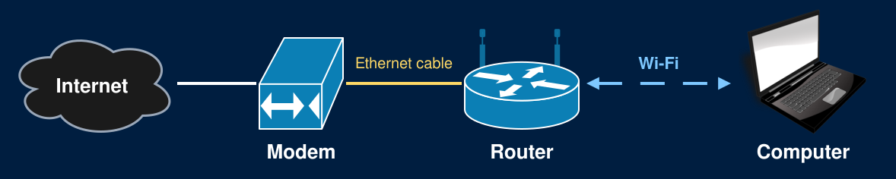{fig-alt="A home network. The Internet connects to a modem, an Ethernet cable connects the modem to a router, and the router talks to a computer over Wi-Fi."}

## Internet Service Provider (ISP)

Connect customers to The Internet

:::: {.columns}
::: {.column width="50%"}
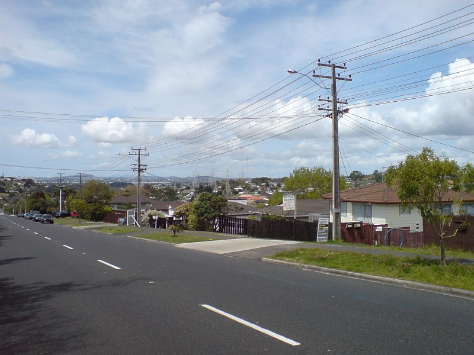{fig-alt="Utility poles carrying cables along a suburban street"}
:::
::: {.column width="50%"}
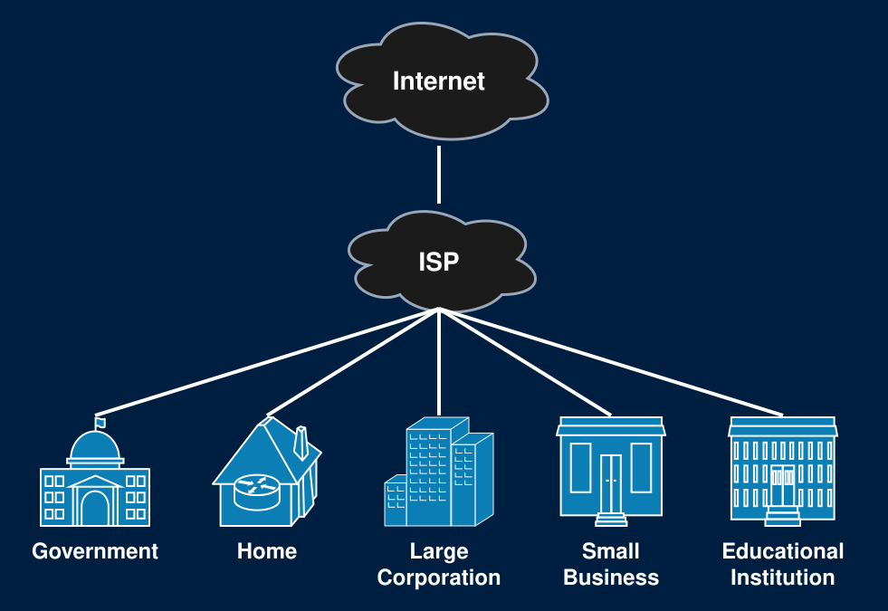{fig-alt="An ISP connecting 5 different customers to the Internet: a government building, a home, a large corporation, a small business, and an educational institution"}
:::
::::

## Tier 1 Networks

Tier 1 networks form the backbone of the Internet

:::: {.columns}
::: {.column width="33%"}
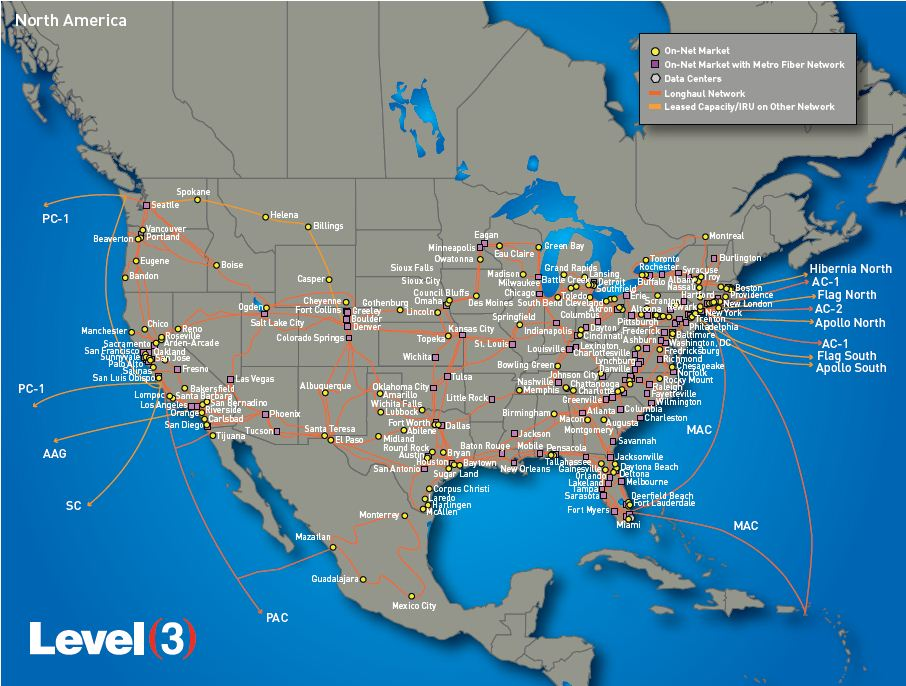{fig-alt="Map of the CenturyLink tier 1 network covering the United States"}
:::
::: {.column width="34%"}
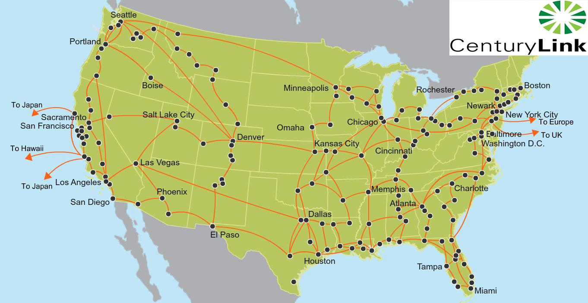{fig-alt="Map of the Level 3 tier 1 network covering the United States"}
:::
::: {.column width="33%"}
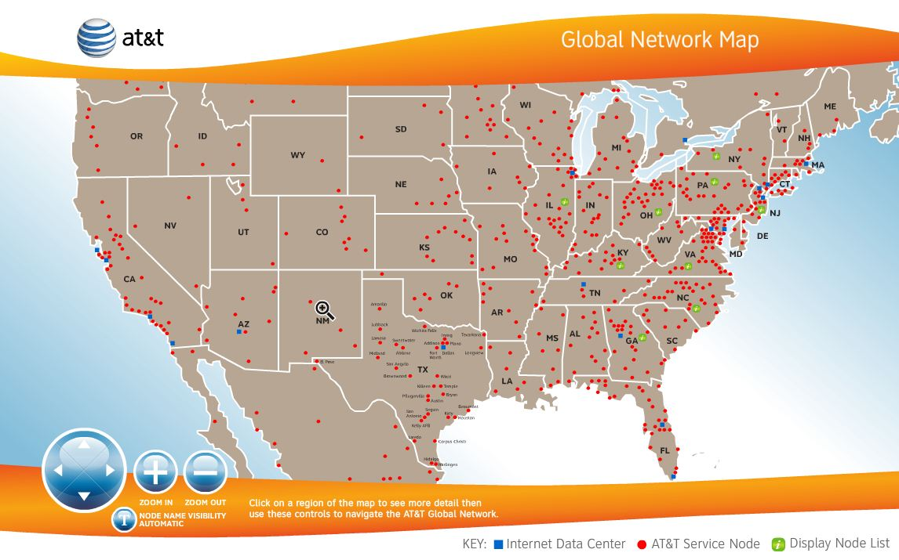{fig-alt="Map of the AT&T tier 1 network covering the United States"}
:::
::::

## Data Centers Power Apps

:::: {.columns}
::: {.column width="50%"}
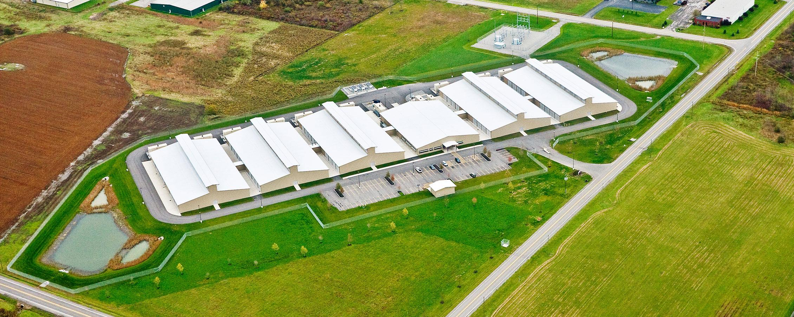{fig-alt="Aerial photo of the Lockport data center"}
:::
::: {.column width="50%"}
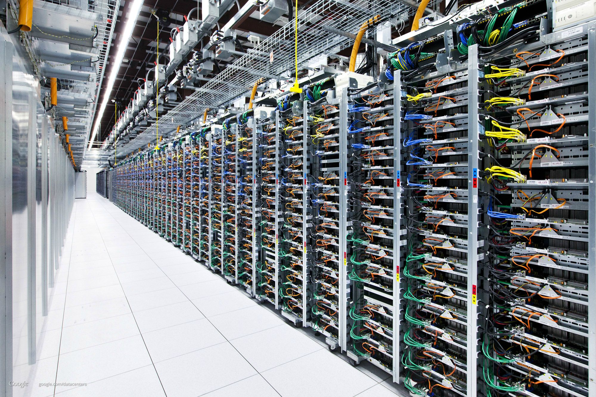{fig-alt="Inside of a data center showing dozens of racks of servers"}
:::
::::

## It's all Cables!

:::: {.columns}
::: {.column width="30%"}
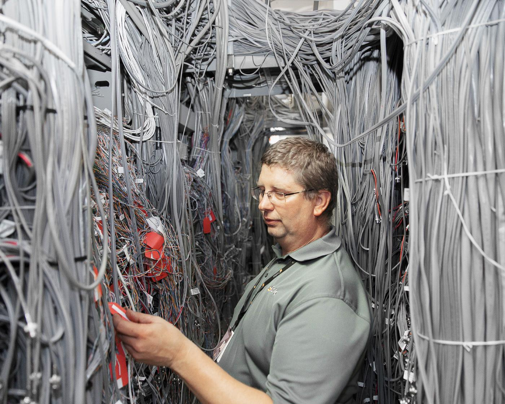{fig-alt="A technician working in a room with 100's of ethernet cables"}
:::
::: {.column width="70%"}
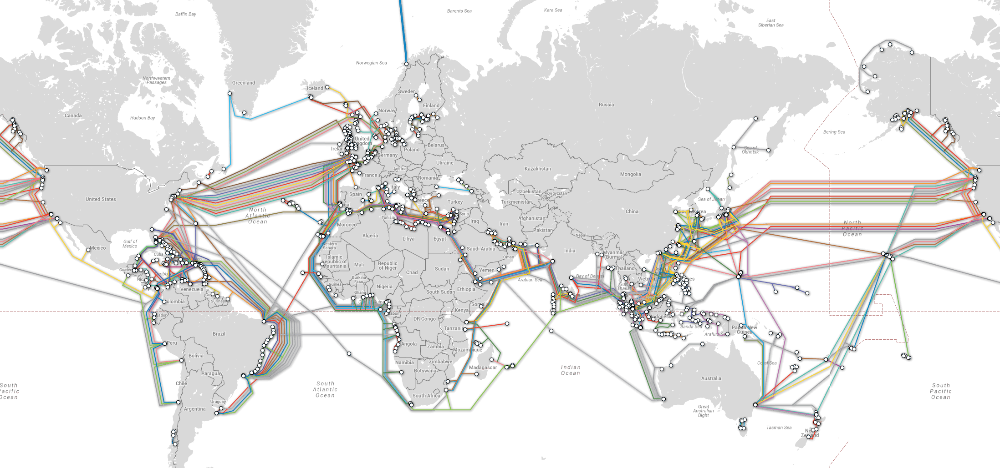{fig-alt="Map of the earth showing undersea cables that cross the oceans and connect the continents"}
:::
::::

## How do we use these cables?..

# Internet Protocol

## Internet Protocol (IP) Address

- Every device has an IP Address
  - Use this address to send messages to that device
  - Ex: 172.217.12.211
- Use DNS (Domain Name Server) to lookup IP address by domain name

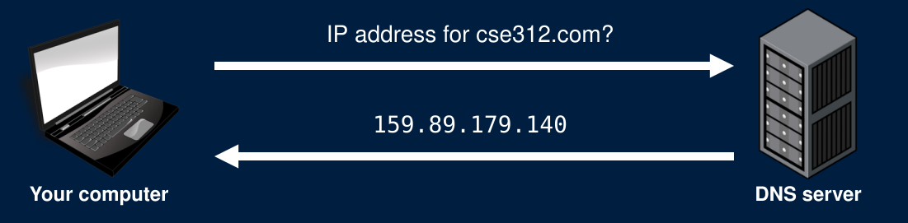{fig-alt="Your computer asks a DNS server for the IP address of cse312.com. The DNS server replies with 159.89.179.140."}

## Data is sent over the Internet in packets/datagrams

- Each packet contains headers containing information about the packet

- Large messages are sent in multiple packets

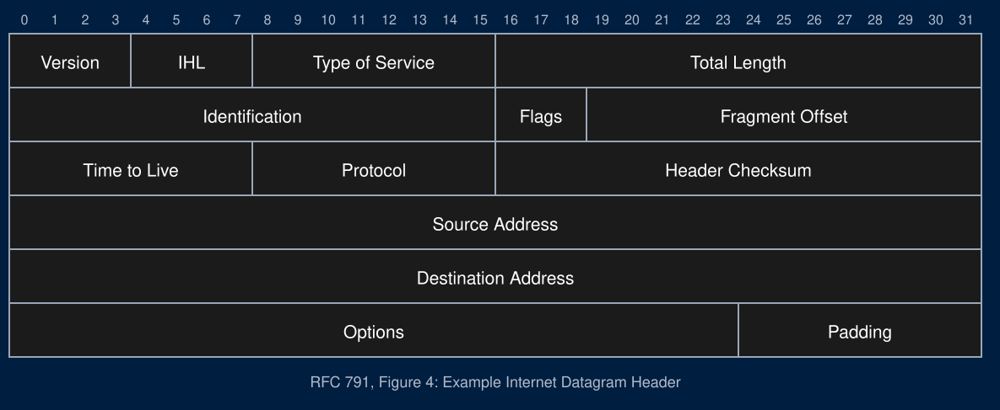{fig-alt="The IPv4 header from RFC 791, 32 bits per row. Row 1: Version (4 bits), IHL (4 bits), Type of Service (8 bits), Total Length (16 bits). Row 2: Identification (16 bits), Flags (3 bits), Fragment Offset (13 bits). Row 3: Time to Live (8 bits), Protocol (8 bits), Header Checksum (16 bits). Row 4: Source Address (32 bits). Row 5: Destination Address (32 bits). Row 6: Options (24 bits), Padding (8 bits)."}

## Routing Packets

- To route a packet through the Internet, a router will
  1. Check the destination IP address of the packet
  2. Send the packet to the next router on its path
  3. Fuhgettaboutit

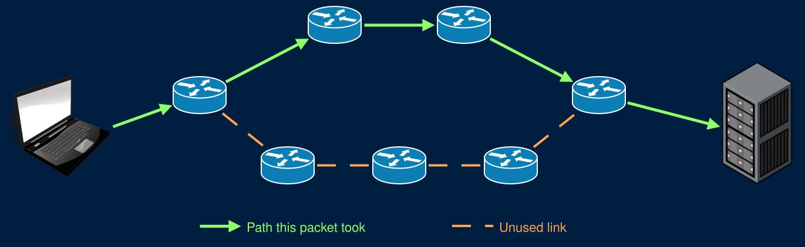{fig-alt="A computer sends a packet to a server through a network of seven routers. There are two paths from the first router to the last. The packet takes the top path, router to router, to the server. The bottom path is unused."}

## The Internet is Unreliable

Many factors cause packets to be dropped

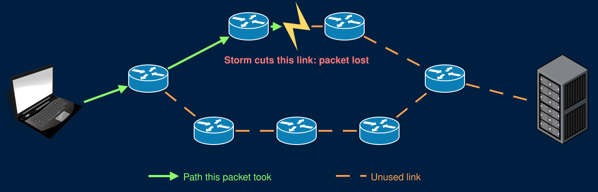{fig-alt="The same network. The packet travels from the computer to the first router, then to the second router on the top path. A storm cuts the link between the second and third routers, so the packet is lost and never reaches the server."}

# Transmission Control Protocol

## Transmission Control Protocol (TCP)

- Makes the Internet reliable
- Detect and resend dropped packets
- Adds port numbers to identify specific programs
- Connect to a port number/IP address combination (TCP/IP)
  - 127.0.0.1:8080

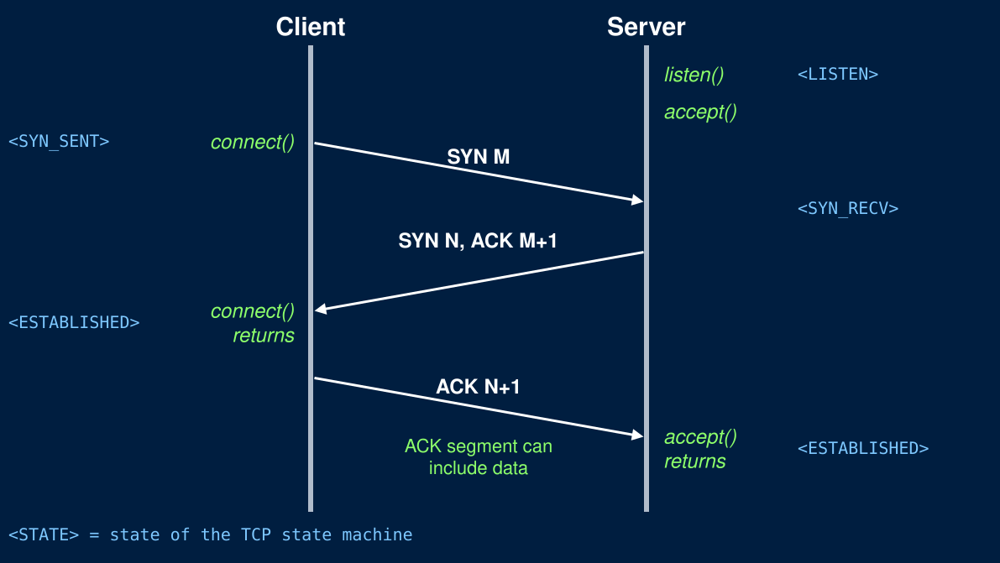{fig-alt="TCP 3-way handshake between a client and a server. The server calls listen() and is in the LISTEN state, then calls accept(). The client calls connect() and enters SYN_SENT, sending SYN M. The server enters SYN_RECV and replies SYN N, ACK M+1. connect() returns and the client is ESTABLISHED. The client sends ACK N+1, which can include data. accept() returns and the server is ESTABLISHED."}

## TCP/IP in CSE312

- Use libraries to do all this for us
- Assume TCP/IP works and that we have reliable communication over the Internet
- Freely send and receive messages (As bytes)
- Your code (HW) will start with HTTP
- Much deeper TCP/IP coverage, and more, in CSE489: Modern Networking Concepts
