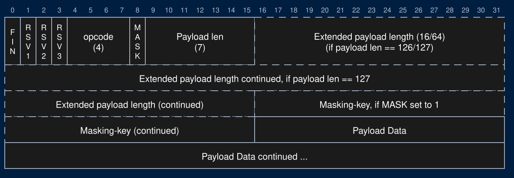

## WebSockets

## AJAX Summary

- Retrieve/Send data from the server after the page loads without a page reload
- To get new data from the server:
  - polling
  - long-polling
- If the server has new data to send to the client
  - Must wait for a poll request

## WebSockets

- Two-way communication between server and client
  - Server can "push" new data to each client without being prompted by an HTTP request
- Enables real-time [minus network delays] communication between users
  - Without long-polling
- Works by keeping a TCP socket open

## WebSocket Overview

- WebSocket protocol:
  - Establish a TCP connection
  - Client sends an HTTP request to upgrade to the WebSocket protocol
  - Server responds confirming the upgrade request
  - Client and server keep the TCP connection open
  - Client and server send WebSocket messages/frames over the TCP connection until one side closes the connection

# The Handshake

## WebSocket Handshake

- When the server receives a WebSocket HTTP request
  - Take steps to keep this TCP socket open as a WebSocket connection
  - These steps ensure that the client knows the server speaks the WS protocol
- After the handshake, client/server can both send messages over the socket

## WebSocket Handshake {.unnumbered .unlisted}

- Client sends an HTTP GET request to the WebSocket path
- Client sets headers
  - Connection: Upgrade
  - Upgrade: websocket
  - Sec-WebSocket-Key: `<random_key>`
- Server responds with 101 Switching Protocols with headers
  - Connection: Upgrade
  - Upgrade: websocket
  - Sec-WebSocket-Accept: `<accept_response>`

## The Handshake Request

```http
GET /websocket HTTP/1.1
Host: localhost:8080
Connection: Upgrade
Upgrade: websocket
Sec-WebSocket-Version: 13
Sec-WebSocket-Key: dGhlIHNhbXBsZSBub25jZQ==
Origin: http://localhost:8080
Cookie: auth_token=8f3a91c2...
```

- A normal HTTP GET request. It arrives through the same keep-alive loop as every other request
- `Sec-WebSocket-Key` is 16 random bytes, base64 encoded, new for every connection
- Note the `Origin` and `Cookie` headers. We'll need both later

## The Handshake Response

```http
HTTP/1.1 101 Switching Protocols
Connection: Upgrade
Upgrade: websocket
Sec-WebSocket-Accept: s3pPLMBiTxaQ9kYGzzhZRbK+xOo=

```

- `101 Switching Protocols` is the last HTTP message on this connection
- No body, so no `Content-Length`
- After the blank line, both sides only send WebSocket frames

## Computing the Accept

- The client generates a random "Sec-WebSocket-Key" for each new WebSocket connection
- The server appends a specific GUID to this key
  - "258EAFA5-E914-47DA-95CA-C5AB0DC85B11"
- Computes the SHA-1 hash
- "Sec-WebSocket-Accept" is the base64 encoding of the hash
- Why?
  - Client ensured that the server speaks the WS protocol properly
    - Highly unlikely this value would be returned by accident
  - Avoid caching

## Why the Sec- Headers?

- Headers that start with `Sec-` are **forbidden headers**
  - Only the browser can set them. JavaScript's `fetch` cannot
- A page can't use `fetch` to fake a WebSocket handshake
- A server that doesn't understand WebSockets, or a cache replaying an old response, won't return the right accept value
- Both sides prove they speak the WebSocket protocol before a single frame is sent
  - Client set a Sec- header so you know it was sent by their browser

# In the Browser

## WebSockets in the Browser

- Create a new WebSocket object with the host/path to connect to
  - Choose a path and set up your server to accept WebSocket requests on that path
- Use `wss://` on a page served over `https://`
  - Browsers block `ws://` connections from `https://` pages (mixed content)

```{.javascript code-line-numbers="1"}
let socket = new WebSocket('ws://' + window.location.host + '/websocket');
socket.onmessage = renderMessage;

function sendMessage(text) {
    socket.send(JSON.stringify({'messageType': 'echo_client', 'text': text}));
}

function renderMessage(message) {
    console.log(message.data);
}
```

## WebSockets in the Browser {.unnumbered .unlisted}

- Set `onmessage` to a function that will be called whenever a message is received
- The argument of the call will contain the message

```{.javascript code-line-numbers="2,8-10"}
let socket = new WebSocket('ws://' + window.location.host + '/websocket');
socket.onmessage = renderMessage;

function sendMessage(text) {
    socket.send(JSON.stringify({'messageType': 'echo_client', 'text': text}));
}

function renderMessage(message) {
    console.log(message.data);
}
```

## WebSockets in the Browser {.unnumbered .unlisted}

- Call the `send` method to send a message to the server
- Can give it a String and the WebSocket object will convert it to a frame
  - We'll parse this frame on the server

```{.javascript code-line-numbers="4-6"}
let socket = new WebSocket('ws://' + window.location.host + '/websocket');
socket.onmessage = renderMessage;

function sendMessage(text) {
    socket.send(JSON.stringify({'messageType': 'echo_client', 'text': text}));
}

function renderMessage(message) {
    console.log(message.data);
}
```

# Authenticating a WebSocket

## Who Is On This Connection?

- WebSocket frames have no headers, and therefore no cookies (No auth token)
- The handshake is the [only]{.yellow} HTTP request on a WebSocket connection
  - The browser attaches its cookies to it, including the auth token
  - This is your only chance to authenticate the user
- Authenticate during the handshake, before sending the 101
  - Same as any other request: read the `auth_token` cookie, hash it, look it up
  - Store the username with *this* connection
- Every frame on this connection is from that user, for as long as the connection is open

## Never Trust the Message

```json
{"messageType": "direct_message", "fromUser": "admin", "text": "Trust me"}
```

- Anyone can open a WebSocket to your server and send any message they want
- Never use a username, or any other identity, that arrives in a message
- The only identity you trust is the one you authenticated in the handshake
- No auth token? The connection is a guest for as long as it's open
  - Guests can still use features that don't require an account

## Authentication is Frozen

- The connection keeps the identity it had during the handshake
  - The user logs out in another tab: this connection is still logged in as them
  - The user logs in after the page loads: this connection is still a guest
- Common solutions:
  - The front end reconnects after a login or logout (a page reload does this)
  - On logout, the server closes every connection that belongs to that user
- Long-lived connections make you think about *when* authentication is checked

# Cross-Site WebSocket Hijacking

## Recall: XSRF

- A malicious page sends a request to your server
- The browser attaches the victim's cookies
- The Same-Origin Policy stops the attacker from **reading** the response
- XSRF tokens stop your server from **accepting** the request

## The SOP and WebSockets

- [The Same-Origin Policy does not apply to WebSockets]{.yellow}
  - No preflight
  - No CORS
  - Any page can open a WebSocket to any server and read every message
- The WebSocket protocol made a different choice
  - The browser tells the server which origin the page is from
  - The server decides whether to accept the connection

## The Attack

```html
<script>
  const socket = new WebSocket("ws://localhost:8080/websocket");
  socket.onopen = () => socket.send(JSON.stringify(
      {"messageType": "direct_message", "targetUser": "cse312", "text": "Sent by the attacker"}));
  socket.onmessage = (message) => console.log("Stolen: " + message.data);
</script>
```

- The victim visits the attacker's page while logged in to your app
- The browser sends the handshake with the victim's cookies
- Your server authenticates the connection as the victim
- The attacker can send messages **and read every message** as the victim
  - XSRF + reading the responses = a hijacked session

## SameSite and WebSockets

- The handshake is not a navigation
  - `Lax` cookies are not sent on a **cross-site** handshake
- A cross-site attack fails if the auth cookie is `Lax` or `Strict`
  - Browsers disagree on the default when `SameSite` is not set
- A **same-site** attack works, even with `Strict`
  - A different subdomain, or a different port
  - `http://localhost:5000` attacking `http://localhost:8080` is same-site!
- Browser protections help most users, not all
  - We need protection on our server

## The Origin Header

- Browsers send an `Origin` header with every WebSocket handshake
- `Origin` is a forbidden header. JavaScript can't change it
  - In a browser, the `Origin` is honest
- A script or curl can send any `Origin` it wants
  - But it doesn't have the victim's cookies. It can only authenticate as itself
- RFC 6455: servers should check the `Origin` and respond `403 Forbidden` if it isn't one they expect
- Your origin changes when you deploy. Keep the allowed origins in an environment variable


## Tickets

- Extra protection that works like an XSRF token:
  1. The page sends `POST /api/websocket-ticket` with its XSRF token
  2. The server responds with a random ticket: single use, expires in ~30 seconds, tied to this user
  3. The page connects to `/websocket?ticket=...`
  4. The server verifies the ticket during the handshake, then deletes it
- The attacker's page can't read the ticket. The SOP applies to the `fetch`
- Short-lived and single use since URLs often end up in logs

# After the Handshake

## The Connection Changes Protocols

- Recall the keep-alive loop: read a request, send a response, repeat
- After you send the 101, [the next bytes on this socket are WebSocket frames, not HTTP requests]{.yellow}
  - Never pass this connection back to your HTTP parsing
  - Switch to a WebSocket loop: read a frame, handle it, repeat
  - Until a close frame or an error
- The goroutine for this connection now lives as long as the WebSocket: minutes, or hours

## Many Connections

- Every open tab is an open TCP connection and a goroutine on your server
- Features like broadcasting must reach *other* connections
  - Store your connections in a data structure that every goroutine can reach
  - Along with the user you authenticated for each connection
- Many goroutines sharing the same data at the same time...
  - Proper concurrency matters

## WebSocket Frames

- Once the connection is established
  - Two-way communication via web socket frames
- A frame is a specifically formatted sequence of bits containing the message to be sent
  - Yes, bits! (And you thought bytes were fun!)
- Parse these bits to read the message

## WebSocket Frame

- https://tools.ietf.org/html/rfc6455#section-5.2
- We'll see how to parse through this next time

{fig-alt="The WebSocket frame format from RFC 6455 section 5.2, 32 bits per row. In order: FIN (1 bit), RSV1, RSV2, and RSV3 (1 bit each), opcode (4 bits), MASK (1 bit), payload len (7 bits), an extended payload length of 16 bits if payload len is 126 or 64 bits if it is 127, a 4-byte masking key if MASK is 1, then the payload data. The optional fields have dashed borders."}
