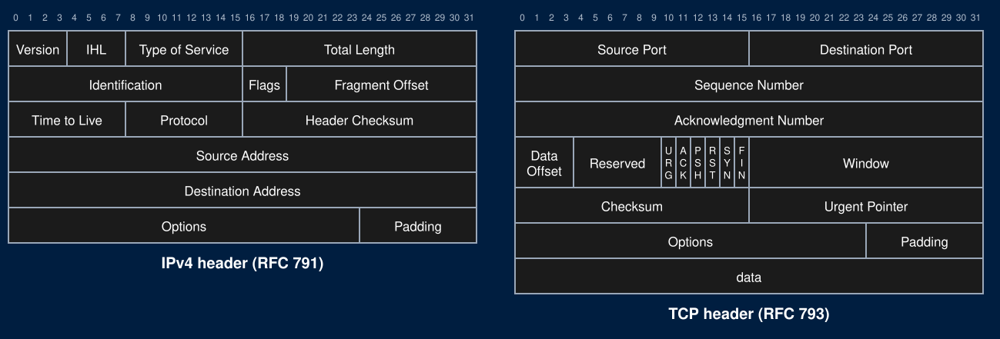
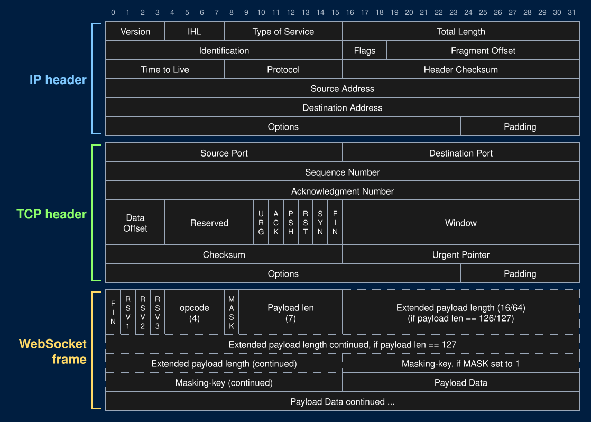

# WebSockets

## WebSockets

- Last time we saw how to establish a WebSocket connection
- Today, we'll parse and send messages over the socket


## WebSocket Frame


https://tools.ietf.org/html/rfc6455#section-5.2

{fig-alt="The WebSocket frame format from RFC 6455 section 5.2, 32 bits per row. In order: FIN (1 bit), RSV1, RSV2, and RSV3 (1 bit each), opcode (4 bits), MASK (1 bit), payload len (7 bits), an extended payload length of 16 bits if payload len is 126 or 64 bits if it is 127, a 4-byte masking key if MASK is 1, then the payload data. The optional fields have dashed borders."}

## Protocols Sidenote

- Many of the protocols used in the Internet define the order and meaning of bits that are sent
  - Sender assembles the bits of a message following the protocol
  - Send the bits through the Internet
  - Receiver interprets the bits following the same protocol to extract meaning from the bits
- Protocols enable complex communication using only 1's and 0's

## Protocols Sidenote


- TCP/IP protocol headers shown here
- Routers read the IP header following this protocol to know how to route a packet
- Endpoints follow the TCP protocol to assemble a sequence of packets and send it to the process using the given port

{fig-alt="Left: the IPv4 header from RFC 791, 32 bits per row: Version, IHL, Type of Service, Total Length; Identification, Flags, Fragment Offset; Time to Live, Protocol, Header Checksum; Source Address; Destination Address; Options, Padding. Right: the TCP header from RFC 793: Source Port, Destination Port; Sequence Number; Acknowledgment Number; Data Offset, Reserved, the URG, ACK, PSH, RST, SYN, and FIN flags, Window; Checksum, Urgent Pointer; Options, Padding; then data."}

## WebSocket Frame

- The WebSocket protocol functions the same way
- Client and server agree to follow this protocol
- Send bits in this specific order
  - We can rely on the client following this protocol

{fig-alt="The WebSocket frame format from RFC 6455 section 5.2, the same diagram as earlier: FIN, RSV1-3, opcode, MASK, payload len, optional extended payload length, optional masking key, payload data."}

## Network Stack

- An IP packet containing a WebSocket frame looks like this

{fig-alt="Three headers stacked in the order they are sent: the IP header, then the TCP header, then the WebSocket frame. The IP header holds Version, IHL, Type of Service, Total Length, Identification, Flags, Fragment Offset, Time to Live, Protocol, Header Checksum, Source Address, Destination Address, Options, and Padding. The TCP header holds Source Port, Destination Port, Sequence Number, Acknowledgment Number, Data Offset, Reserved, flags, Window, Checksum, Urgent Pointer, Options, and Padding. The WebSocket frame holds FIN, RSV1-3, opcode, MASK, payload len, extended payload length, masking key, and payload data."}

# Parsing Frames

## Parsing Bits

- We will have to read frames at the bit level
  - It's already in a byte array when we receive it
  - We can access any byte and extract the bits we need
  - Helpful to recall that bytes are represented as 8-bit integer values (0-255)

{fig-alt="The WebSocket frame format from RFC 6455 section 5.2, the same diagram as earlier: FIN, RSV1-3, opcode, MASK, payload len, optional extended payload length, optional masking key, payload data."}

## Parsing Bits Recall

- To read the opcode:
  - get the byte at index 0
  - Bitwise AND this byte with a "bit mask" of 0x0F (00001111)
  - This will 0 out the 4 higher order bits
  - We now have an int from 0-15 representing the opcode
- To read the FIN bit:
  - Shift the first byte right by 7 bits

{fig-alt="The WebSocket frame format from RFC 6455 section 5.2, the same diagram as earlier: FIN, RSV1-3, opcode, MASK, payload len, optional extended payload length, optional masking key, payload data."}

## WebSocket Frame

- FIN: The finish bit
  - 1 - This is the last frame for this message
  - 0 - There will be continuation frames containing more data for the same message
- More about this in the next lecture
  - Until then, it will always be 1

{fig-alt="The WebSocket frame format from RFC 6455 section 5.2, the same diagram as earlier: FIN, RSV1-3, opcode, MASK, payload len, optional extended payload length, optional masking key, payload data."}

## WebSocket Frame

- RSV: Reserved bits
  - Used to specify any extensions being used
  - Nonzero only if the client and server agreed on an extension in the handshake
  - Chrome offers `Sec-WebSocket-Extensions: permessage-deflate`. Your 101 response doesn't accept it, so no extension is used
- [You can assume these are always 000 for the HW]

{fig-alt="The WebSocket frame format from RFC 6455 section 5.2, the same diagram as earlier: FIN, RSV1-3, opcode, MASK, payload len, optional extended payload length, optional masking key, payload data."}

## WebSocket Frame

- opcode: Operation code
  - Specifies the type of information contained in the payload

{fig-alt="The WebSocket frame format from RFC 6455 section 5.2, the same diagram as earlier: FIN, RSV1-3, opcode, MASK, payload len, optional extended payload length, optional masking key, payload data."}

## Opcodes

| Opcode | Type |
|---|---|
| 0000 | Continuation Frame |
| 0001 | Text |
| 0010 | Binary |
| 1000 | Close |
| 1001 | Ping |
| 1010 | Pong |

- Opcodes 1000 and above are **control frames**


## WebSocket Frame

- MASK: Mask bit
  - Set to 1 if a mask is being used
  - Set to 0 if no mask is being used
- This will **always** be 1 when receiving messages from a client
- You will **always** set this to 0 when sending a frame from your server

{fig-alt="The WebSocket frame format from RFC 6455 section 5.2, the same diagram as earlier: FIN, RSV1-3, opcode, MASK, payload len, optional extended payload length, optional masking key, payload data."}

## Frame Length

- The next bits will represent payload length in bytes
  - Similar to Content-Length
- The length can be represented in 7, 16, or 64 bits

{fig-alt="The WebSocket frame format from RFC 6455 section 5.2, the same diagram as earlier: FIN, RSV1-3, opcode, MASK, payload len, optional extended payload length, optional masking key, payload data."}

## Frame Length

- If the length is <126 bytes
  - The length is represented in 7 bits, sharing a byte with the MASK bit
  - The next bit after the length is either the mask or payload

{fig-alt="The WebSocket frame format from RFC 6455 section 5.2, the same diagram as earlier: FIN, RSV1-3, opcode, MASK, payload len, optional extended payload length, optional masking key, payload data."}

## Frame Length

- If the length is >=126 and <65536 bytes
  - The 7 bit length will be exactly 126 (1111110)
  - The next 16 bits represents the payload length

{fig-alt="The WebSocket frame format from RFC 6455 section 5.2, the same diagram as earlier: FIN, RSV1-3, opcode, MASK, payload len, optional extended payload length, optional masking key, payload data."}

## Frame Length

- If the length is >=65536 bytes
  - The 7 bit length will be exactly 127 (1111111)
  - The next 64 bits represents the payload length
  - 18,446,744,073,709,551,615 max length!
    - 16 exabytes / 16,000,000 terabytes

{fig-alt="The WebSocket frame format from RFC 6455 section 5.2, the same diagram as earlier: FIN, RSV1-3, opcode, MASK, payload len, optional extended payload length, optional masking key, payload data."}

## Frame Length

- To read the frame length, read the 7 bit length
  - If the value is 126, read the next 16 bits as the length
  - If the value is 127, read the next 64 bits as the length
  - Else, the value itself is the length

{fig-alt="The WebSocket frame format from RFC 6455 section 5.2, the same diagram as earlier: FIN, RSV1-3, opcode, MASK, payload len, optional extended payload length, optional masking key, payload data."}

## Byte Order

- Multi-byte values sent over a network are **big-endian**
  - Most significant byte first. Also called "network byte order"
  - IP and TCP headers, the 16 and 64 bit WebSocket lengths, and the close frame status code
- The bytes `[0x01, 0x2C]` as a 16-bit length are `0x012C` = 300
  - Read them little-endian and you get `0x2C01` = 11265
- On the HW, you allowed to research and use packages that perform byte/int conversions

## Mask and Payload

- After all the payload length bits:
  - If the MASK bit == 1 (client to server messages), the next 4 bytes is the masking key
  - If the MASK bit == 0 (server to client and all control frames), the payload begins

{fig-alt="The WebSocket frame format from RFC 6455 section 5.2, the same diagram as earlier: FIN, RSV1-3, opcode, MASK, payload len, optional extended payload length, optional masking key, payload data."}

## Mask and Payload

- If there is a mask, read these 4 bytes
- The mask will be randomly generated by the client for each message
  - You must parse this each time a message is received

{fig-alt="The WebSocket frame format from RFC 6455 section 5.2, the same diagram as earlier: FIN, RSV1-3, opcode, MASK, payload len, optional extended payload length, optional masking key, payload data."}

## Mask and Payload

- Each 4 bytes of the payload has been XORed with the mask by the client
- Byte `i` of the payload was XORed with byte `i % 4` of the mask
  - XOR it with the same mask byte again to get the original byte back
- If the length is not a multiple of 4, the last few bytes only use the first bytes of the mask
  - i.e. Always reading 4 bytes at a time will cause an index out of bounds error ~75% of the time

{fig-alt="The WebSocket frame format from RFC 6455 section 5.2, the same diagram as earlier: FIN, RSV1-3, opcode, MASK, payload len, optional extended payload length, optional masking key, payload data."}

## XOR Example

- If 4 bytes of the message are:
  - `01001001 01000011 01010101 00100001`
- And the random mask is:
  - `01111011 00100010 01110101 01110011`
- This part of the payload will be "message XOR mask":
  - `00110010 01100001 00100000 01010010`
- When we receive these bits and XOR it with the mask again we get the original message bits:
  - `01001001 01000011 01010101 00100001`

## Mask and Payload


- Once the payload is XORed with the mask 4 bytes at time we get the entire message
- Then process the message

{fig-alt="The WebSocket frame format from RFC 6455 section 5.2, the same diagram as earlier: FIN, RSV1-3, opcode, MASK, payload len, optional extended payload length, optional masking key, payload data."}

# Why Mask?

## Masking Is Not Encryption

- The mask is sent in the same frame as the payload
- Anyone who can see the frame can unmask it
- So why does the browser mask every frame it sends?

## Proxy Cache Poisoning

- Many networks send all web traffic through a proxy (schools, companies, ISPs)
  - It caches responses to speed things up for everyone on the network
- Some proxies didn't understand `Upgrade`
  - They kept reading the bytes after the handshake as if they were HTTP
- Without masking, the attacker's JavaScript chooses the exact bytes on the wire

```javascript
const socket = new WebSocket("ws://attacker.com/websocket");
socket.send("GET /jquery.js HTTP/1.1\r\nHost: popular-site.com\r\n\r\n");
```

- The proxy sees a request for `popular-site.com/jquery.js` on a connection to the attacker's server
  - The attacker's server responds with malicious JavaScript
  - The proxy caches it as `popular-site.com/jquery.js` [for everyone on the network]{.yellow}

## Masking Fixes It

- The browser picks a new random mask for every frame
- The attacker's JavaScript chooses the payload, but can't predict the bytes on the wire
  - It can't make them look like an HTTP request to anything in between
- Frames from the server aren't masked
  - The attacker's server can already send any bytes it wants. A mask wouldn't stop anything
- Researchers demonstrated this attack in 2011 while WebSockets were being standardized
  - Masking was added to the protocol because of it

# Control Frames

## Close Frames

- Opcode: 1000
- Either side may send a close frame to end the connection
- Optional payload: a 2-byte status code (big-endian), then an optional reason in UTF-8
  - 1000: Normal closure
  - 1001: Going away (the tab closed, the server is shutting down)
  - 1002: Protocol error
  - 1009: Message too big
- When you receive a close frame: send a close frame back, then close the TCP connection

## Close Frame Structure

A server (no mask) closing normally (status code 1000, no reason): `0x88 0x02 0x03 0xE8`

| Byte | Bits | Meaning |
|---|---|---|
| 0 | `10001000` | FIN = 1, RSV = 000, opcode = 1000 (close) |
| 1 | `00000010` | MASK = 0, payload length = 2 |
| 2-3 | `00000011 11101000` | Status code `0x03E8` = 1000 (big-endian) |
| 4+ | | Optional reason in UTF-8 (none here) |

## Reading a Close Frame

- The status code is the first 2 bytes of the payload
  - `code := binary.BigEndian.Uint16(payload[0:2])`
- Close frames from the client are masked like any other frame
  - Unmask the payload before reading the code
- The payload may be empty, with no status code at all
  - Check the length before reading 2 bytes

## Ping and Pong

- Ping (1001): "Are you still there?"
- Pong (1010): "Yes"
  - Must contain the same payload as the ping it answers
- Browsers answer pings automatically
  - JavaScript never sees them, and can't send them
- Servers send pings to check on their clients

## Why Ping?

- A browser sends a close frame when a tab closes normally
- Laptop lid closed, Wi-Fi drops, phone goes into a tunnel: [nothing is sent]{.yellow}
  - No close frame. The connection looks open forever
  - Your server can't tell a quiet connection from a dead one
- Ping regularly
  - If you don't see a pong in return, the connection is dead

