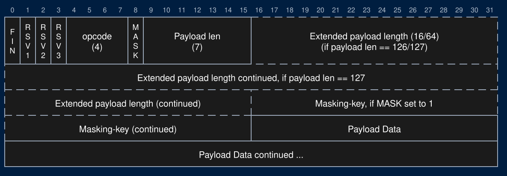
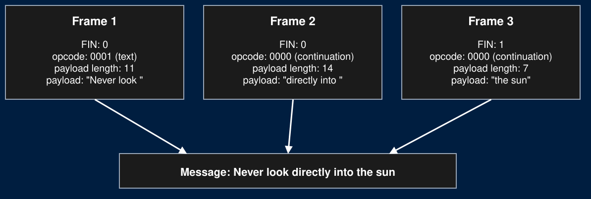
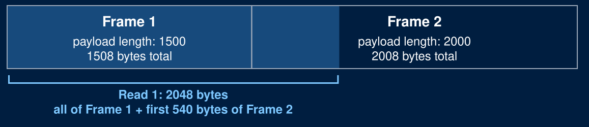
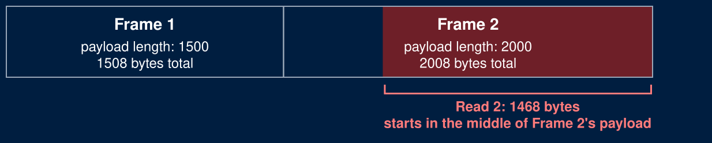
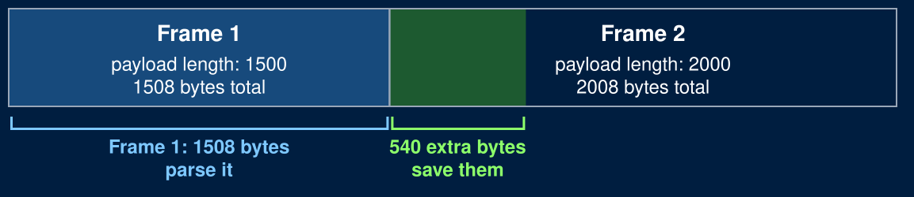
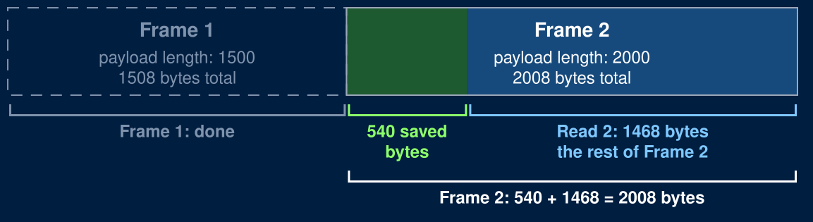
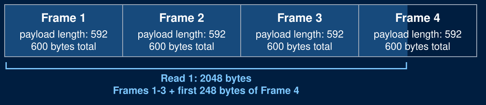
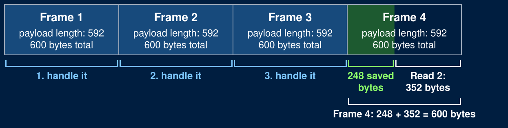

# WebSocket Buffers

## TCP is a Stream

- TCP delivers a stream of bytes, not messages
- One `Read` from the socket can return:
  - Part of a frame
  - Exactly one frame
  - The end of one frame and the start of the next
  - Several frames
- The only way to delimit frames is by payload length
  - Just like `Content-Length` for HTTP requests

## Special Cases

- We'll talk about 4 special cases that will come up when implementing WebSockets
  - Buffering large frames
  - Multiple frames per message using the fin bit and continuation frames
  - Control frames in the middle of a multi-frame message
  - Multiple frames being sent back-to-back

# Buffering Large Frames

## Buffering Large Frames

- You will sometimes receive WebSocket frames that are large enough that they need to be buffered
  - Buffering frames is very similar to buffering HTTP requests
- When receiving a WebSocket Frame:
  - Read bytes from the socket
  - Parse the headers
  - Read the payload length from the headers
  - Keep reading bytes from the socket until you've read the entire frame
    - Payload length does not include the header bytes
    - Size of headers depends on the payload length (2 or 8 extra bytes) and mask (4 extra bytes)
  - Process the frame

# Continuation Frames

## Continuation Frames

- You will sometimes receive very large messages from clients that will be sent in multiple frames
  - Fin bit will be 0 until the last frame
  - opcode will be 0000 for all but the first frame
  - Payload length is only the length of that frame
- Sending a message >131,072 (2^17) bytes in Chrome will be sent in multiple frames
  - Great for testing since this is predictable
- Firefox will send messages in a single frame
- Test thoroughly. If you only test in Firefox, you did not test this feature

## Continuation Frames

- When you read a frame with a fin bit of 0:
  - Keep reading frames until you read a frame with a fin bit of 1 and opcode of 0000
  - Combine the payload of all frames, then process the entire message

{fig-alt="The WebSocket frame format from RFC 6455 section 5.2, the same diagram as earlier: FIN, RSV1-3, opcode, MASK, payload len, optional extended payload length, optional masking key, payload data."}

## Continuation Frames

- One message sent over 3 frames

{fig-alt="Three frames. Frame 1: FIN 0, opcode 0001 (text), payload length 11, payload \"Never look \". Frame 2: FIN 0, opcode 0000 (continuation), payload length 14, payload \"directly into \". Frame 3: FIN 1, opcode 0000 (continuation), payload length 7, payload \"the sun\". Arrows from all three point to the combined message: Never look directly into the sun."}

## Control Frames Mid-Message

- Control frames (close, ping, pong) can arrive [between the frames of a fragmented message]{.yellow}
  - They are never fragmented themselves
- Example: a pong arrives in the middle of "Never look directly into the sun"

| Frame | FIN | Opcode | Payload |
|---|---|---|---|
| 1 | 0 | 0001 (text) | "Never look " |
| 2 | 1 | 1010 (pong) | |
| 3 | 0 | 0000 (continuation) | "directly into " |
| 4 | 1 | 0000 (continuation) | "the sun" |

- Handle the pong right away. Don't add it to the message
- On HW4 your server pings every 5 seconds. A large message will be interrupted eventually
  - This will be checked during grading of objective 3

# Back-to-back Frames

## Back-to-back Frames

- Multiple WebSocket frames can be sent back-to-back on the same connection
  - Nearly guaranteed when continuation frames are used
- If you read more bytes than you expect, you have read the headers of the next frame
- Use the payload length to delimit frames
  - If you read < payload length bytes, you should buffer
  - If you read > payload length bytes, store the extra bytes as the start of the next frame

## Back-to-back Frames

- Two frames are sent by the client back-to-back
  - The first frame has a payload length of 1500
    - 1508 total bytes including headers
  - The second frame has a payload length of 2000
    - 2008 total bytes including headers
- Both frames have been processed by TCP and are ready to be read

| Frame | FIN | Payload Length | Total Bytes |
|---|---|---|---|
| 1 | 1 | 1500 | 1508 |
| 2 | 1 | 2000 | 2008 |

## Back-to-back Frames {.unnumbered .unlisted}

- There are 3516 bytes ready to be read from the socket
- And you call `conn.Read(buffer)` with a 2048 byte buffer
  - This will read up to 2048 bytes from the socket
  - There are >2048 bytes ready, so you get the first 2048
- You read the entirety of the first frame, and the first 540 bytes of the second frame

{fig-alt="Frame 1 (payload length 1500, 1508 bytes total) followed by Frame 2 (payload length 2000, 2008 bytes total). A bracket labeled Read 1: 2048 bytes covers all of Frame 1 and the first 540 bytes of Frame 2."}

## Back-to-back Frames {.unnumbered .unlisted}

- If you're not careful, your loop will go back to the socket and read the remaining 1468 bytes of the second frame and attempt to parse it
- Since you start in the middle of the frame, you will run header parsing code on masked payload bytes
  - You will get errors!

::: {.absolute bottom=0 left=0 width="100%"}
{fig-alt="The same two frames. A bracket labeled Read 2: 1468 bytes covers the end of Frame 2, starting in the middle of Frame 2's payload."}
:::

## Back-to-back Frames {.unnumbered .unlisted}

- When parsing the first frame:
  - Use the payload length to detect that you've read too many bytes
  - Store the extra bytes in a separate data structure
  - Parse the first frame

::: {.absolute bottom=0 left=0 width="100%"}
{fig-alt="The same two frames. The first read is split in two. A bracket under Frame 1 reads Frame 1: 1508 bytes, parse it. A bracket under the first 540 bytes of Frame 2 reads 540 extra bytes, save them."}
:::

## Back-to-back Frames {.unnumbered .unlisted}

- When you finish processing the first frame, start parsing the second frame with the stored bytes
- Check the payload length and buffer if needed to read the rest of the frame
- Recommendation: Use your top-level WS loop to do this so you can handle any number of back-to-back frames
  - Only read from the socket if you don't have any stored bytes, or you are buffering with a known payload length

::: {.absolute bottom=0 left=0 width="100%"}
{fig-alt="The same two frames. Frame 1 is dimmed and labeled done. Under Frame 2, one bracket covers the 540 saved bytes and another covers Read 2: 1468 bytes, the rest of Frame 2. A bracket under both reads Frame 2: 540 + 1468 = 2008 bytes."}
:::

## Multiple Frames in One Read

- The client sends 4 small frames back-to-back
  - Each has a payload length of 592: 600 bytes including headers
  - 2400 bytes are ready to be read
- `conn.Read(buffer)` with a 2048 byte buffer returns:
  - All of frames 1, 2, and 3 (1800 bytes)
  - The first 248 bytes of frame 4

::: {.absolute bottom=0 left=0 width="100%"}
{fig-alt="Four back-to-back frames, each with payload length 592 and 600 bytes total. A bracket labeled Read 1: 2048 bytes covers Frames 1, 2, and 3 and the first 248 bytes of Frame 4."}
:::

## Multiple Frames in One Read {.unnumbered .unlisted}

- Handle frames 1, 2, and 3 [before you read again]{.yellow}
- Frame 4 is incomplete: keep its 248 bytes and read more bytes from the socket
  - Second read returns the last 352 bytes of frame 4

::: {.absolute bottom=0 left=0 width="100%"}
{fig-alt="The same four frames. Brackets under Frames 1, 2, and 3 read 1. handle it, 2. handle it, and 3. handle it. Under Frame 4, one bracket covers 248 saved bytes and another covers Read 2: 352 bytes. A bracket under all of Frame 4 reads Frame 4: 248 + 352 = 600 bytes."}
:::

## Don't Assume the Header Arrived

- With back-to-back frames, a read could end in the middle of the headers of a frame
  - Even 1 byte into the next frame's header
- Before parsing a header, check that you have all of its bytes
  - If you don't, read more
- Make sure you have at least 2 bytes before parsing
  - Check the 7-bit payload length to see if you have all the header bytes
  - Buffer as needed
- This will not be explicitly checked during HW4 grading, but you might experience strange bugs if you don't handle it


# Limits

## Don't Trust the Length

- The payload length is chosen by the client
  - The 64-bit length lets an attacker claim a 16 EB frame
- Don't allocate `make([]byte, payloadLength)` from an untrusted length
- An attacker can also send continuation frames forever
  - Limit the total size of a message, not only the size of a frame
- Too big? Send a close frame with status 1009 (Message Too Big) and close the connection

# Testing

## Back-to-back Frames

- To test for back-to-back frames:
  - Edit the front end JavaScript to send a message multiple times when the user sends a message
  - Make sure each message is duplicated the correct number of times
  - With this modification, every echoed message should appear 5 times

```javascript
for (let i = 0; i < 5; i++) {
    socket.send(JSON.stringify({'messageType': 'echo_client', 'text': text}));
}
```

## Testing Without a Browser

- The browser decides how your messages are split. You can't control it
- Write a small Go test client
  - `net.Dial("tcp", "localhost:8080")`, send a handshake, read the 101
  - Then write hand-built frames with exact control over every byte
- Things to try:
  - Two frames in one `Write` (back-to-back)
  - One frame split across two `Write`s with a `time.Sleep` between them (split header)
  - A pong between two continuation frames
- Frames from a client must be masked, but the mask can be `00 00 00 00`
  - XOR with 0 doesn't change the payload, so you can read your test frames
