## WebRTC

## WebRTC

- Need to establish a real-time streaming peer-to-peer connection
- But how?
  - Need the IP address of your peer
  - Need to agree on the details of the connection

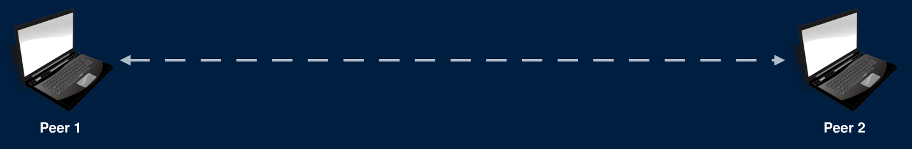{fig-alt="Two peers with a dashed two-way arrow between them: they want a direct peer-to-peer connection."}

## WebRTC - Connecting

- One peer needs to get an offer to the other peer
- This is an offer to establish a connection that contains:
  - audio/visual codec, bitrate, etc details (How to interpret the bytes once the streaming starts)
  - A username fragment ("ice-ufrag") as a unique identifier

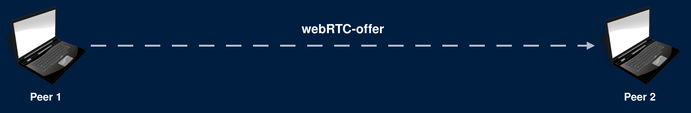{fig-alt="Peer 1 sends a webRTC-offer to peer 2."}

## WebRTC - Connecting

- The peer responds with an answer
- The answer contains their audio/visual data
- Contains their own ufrag so the connection can be identified
- Once the answer is received, the peers agree to connect

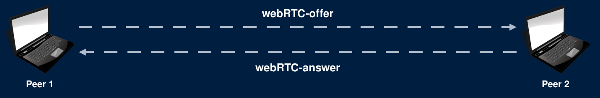{fig-alt="Peer 1 sends a webRTC-offer to peer 2, and peer 2 replies with a webRTC-answer."}

## WebRTC - Connecting

- But there's a problem
- How do we send these messages between two peers?

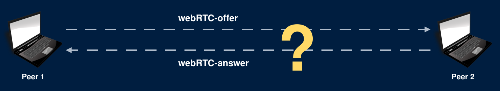{fig-alt="Peer 1 sends a webRTC-offer to peer 2, and peer 2 replies with a webRTC-answer. A large question mark sits between them: how do these messages reach the other peer?"}

## WebRTC - Connecting

- For usual web traffic with a server:
  - Type in a domain name or click a link containing a domain name
  - Use DNS to lookup the [static] IP address of the server
  - Send a request to the IP address on port 80 or 443

{fig-alt="Peer 1 sends a webRTC-offer to peer 2, and peer 2 replies with a webRTC-answer. A large question mark sits between them: how do these messages reach the other peer?"}

## WebRTC - Connecting

- For peer-to-peer traffic:
  - We need to discover the IP and port of the peer without DNS
  - Peer IP/port can change (dynamic IP)

{fig-alt="Peer 1 sends a webRTC-offer to peer 2, and peer 2 replies with a webRTC-answer. A large question mark sits between them: how do these messages reach the other peer?"}

## WebRTC - Signalling Server

- Offer and answer are sent through a signaling server
  - On the HW - You are the signaling server!!
- Both peers connect to your server
- Send offer/answer to the server and the server forwards the messages to the other peer

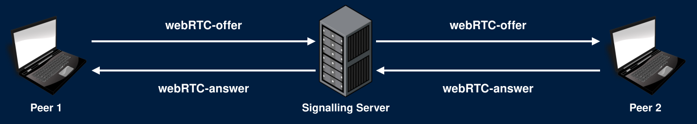{fig-alt="Peer 1 sends a webRTC-offer to the signalling server, which forwards it to peer 2. Peer 2 sends a webRTC-answer to the signalling server, which forwards it to peer 1."}

## WebRTC - Signalling Server

- We need a method to send these messages
- We'll need a way for the server to be able to send messages to each client in real-time

{fig-alt="Peer 1 sends a webRTC-offer to the signalling server, which forwards it to peer 2. Peer 2 sends a webRTC-answer to the signalling server, which forwards it to peer 1."}

## WebRTC - Signalling Server

- We need a method to send these messages
- We'll need a way for the server to be able to send messages to each client in real-time
- Wow! It's really convenient that we have WebSockets!

{fig-alt="Peer 1 sends a webRTC-offer to the signalling server, which forwards it to peer 2. Peer 2 sends a webRTC-answer to the signalling server, which forwards it to peer 1."}

## WebRTC - Signalling Server

- When your server receives a WebSocket frame containing an offer or answer
  - Send the payload to the other peer over their WebSocket

{fig-alt="Peer 1 sends a webRTC-offer to the signalling server, which forwards it to peer 2. Peer 2 sends a webRTC-answer to the signalling server, which forwards it to peer 1."}

## WebRTC - NATs

- We have another issue..
- How do we know the IP address and port for each peer?

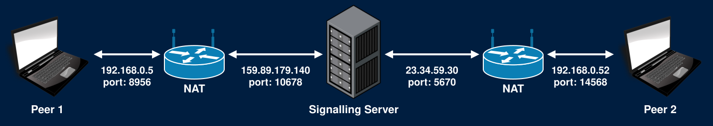{fig-alt="Peer 1 has local address 192.168.0.5 port 8956 behind a NAT, which talks to the signalling server from public address 159.89.179.140 port 10678. Peer 2 has local address 192.168.0.52 port 14568 behind a NAT, which talks to the signalling server from public address 23.34.59.30 port 5670."}

## WebRTC - NATs

- Devices are commonly "hidden" behind NAT routers
  - Network Address Translation
- With a NAT:
  - You have a local IP address for communication on your local network
  - When communicating outside your network, the NAT router sends your message using a public IP address and port number

{fig-alt="Peer 1 has local address 192.168.0.5 port 8956 behind a NAT, which talks to the signalling server from public address 159.89.179.140 port 10678. Peer 2 has local address 192.168.0.52 port 14568 behind a NAT, which talks to the signalling server from public address 23.34.59.30 port 5670."}

## WebRTC - NATs

- With a NAT:
  - Many devices on a local network can share a single public IP address
  - Each device does not know it's public IP/port used when it communicates to the outside world
  - [Also the problem that port-forwarding solves]

{fig-alt="Peer 1 has local address 192.168.0.5 port 8956 behind a NAT, which talks to the signalling server from public address 159.89.179.140 port 10678. Peer 2 has local address 192.168.0.52 port 14568 behind a NAT, which talks to the signalling server from public address 23.34.59.30 port 5670."}

## WebRTC - STUN Server

- Solution: Use a STUN (Session Traversal Utilities for NAT) Server
- Each peer connects to a STUN server and asks for their public IP/port
- STUN server checks the origin IP/port and informs the client
- We'll use Google's free STUN server (stun.l.google.com:19302)

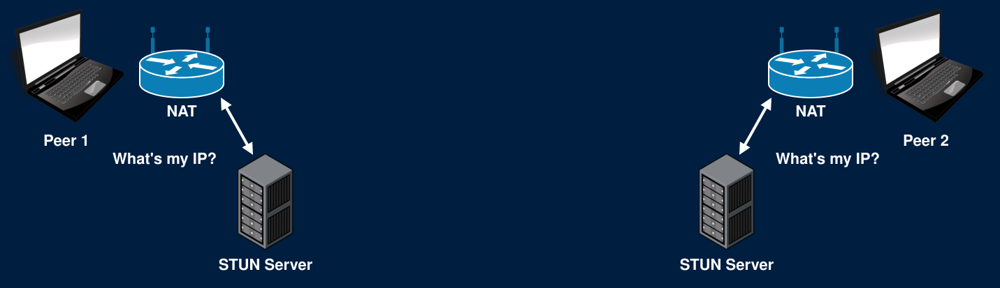{fig-alt="Each peer, behind its NAT, asks a STUN server: What's my IP?"}

## WebRTC - ICE Candidate

- Each peer sends their public IP/port, and connection information, in an ICE (Interactive Connectivity Establishment) candidate message
- Whenever your signaling server receives an ICE candidate, forward it to the other peer

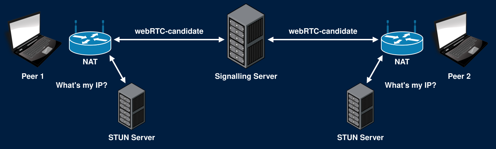{fig-alt="Each peer asks its STUN server: What's my IP? Then each peer sends a webRTC-candidate through the signalling server to the other peer."}

## WebRTC - ICE Candidate

- Candidate contains:
  - Connection type - UDP, not TCP
  - IP/port - Local in this example
  - Username fragment - Uniquely identifies the connection

```{.json .code-overflow-wrap}
{"candidate":"candidate:2382557538 1 udp 2122260223 192.168.1.19 54090 typ host generation 0 ufrag FGP/ network-id 1 network-cost 10","sdpMid":"0","sdpMLineIndex":0}
```

{fig-alt="Each peer asks its STUN server: What's my IP? Then each peer sends a webRTC-candidate through the signalling server to the other peer."}

## WebRTC - Connection

- And now we can establish a peer-to-peer connection!

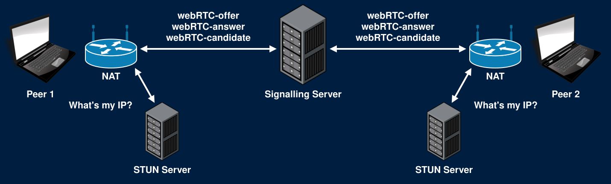{fig-alt="Each peer asks its STUN server: What's my IP? The webRTC-offer, webRTC-answer, and webRTC-candidate messages travel between the peers through the signalling server."}

## WebRTC - Summary

- One peer sends an offer to the other
- Other peer responds with an answer
- Both peers get their public IP/port from their STUN Servers
- Both peers send their ICE candidates to the other

{fig-alt="Each peer asks its STUN server: What's my IP? The webRTC-offer, webRTC-answer, and webRTC-candidate messages travel between the peers through the signalling server."}

## WebRTC - Summary

- Once the connection is established
- The servers step aside and the clients stream directly to each other
  - True peer-to-peer!

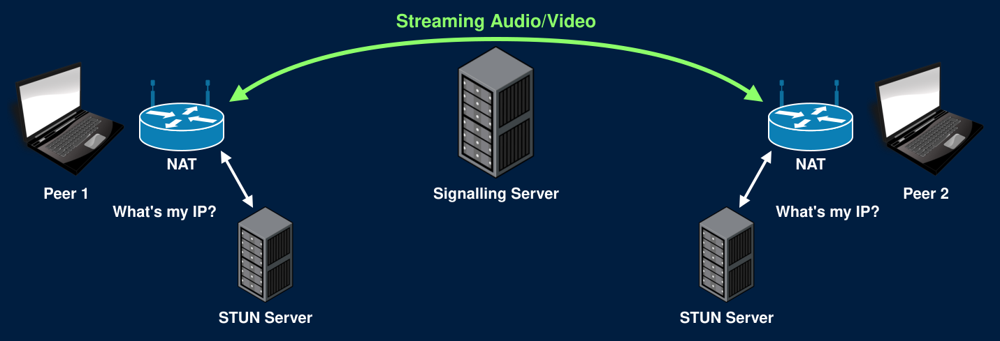{fig-alt="The peers stream audio and video directly to each other. The signalling server and STUN servers are no longer involved."}

## WebRTC - Summary

- Your role in all of this?
  - Route the offer/answer/candidate messages between peers
- No need to read/parse/interpret the RTC portion of these messages
  - Extract the payload from the WS frame, send it to the appropriate peer as a new WS frame

{fig-alt="Each peer asks its STUN server: What's my IP? The webRTC-offer, webRTC-answer, and webRTC-candidate messages travel between the peers through the signalling server."}

## Only Forward Within a Call

- Each offer, answer, and ICE candidate names the socket it should be forwarded to
- Before forwarding, check that the sender and the recipient are in the same call
- Otherwise any user can send WebRTC messages to any connection on your server
  - Spam other users with offers
  - Collect other users' IP addresses from the answers and ICE candidates they send back

## WebRTC - Restrictions

- The browser will not allow WebRTC connections when connected to a site using HTTP (as opposed to HTTPS)
- Must have an encrypted connection to use WebRTC
  - *Unless connecting over localhost (Let's us test locally)

{fig-alt="Each peer asks its STUN server: What's my IP? The webRTC-offer, webRTC-answer, and webRTC-candidate messages travel between the peers through the signalling server."}

## WebRTC - Restrictions

- Sometimes a peer-to-peer connection cannot even be established
  - Can have restrictive firewalls
  - Dynamic NATs might change your port unexpectedly
  - Organizations might block certain traffic on their network

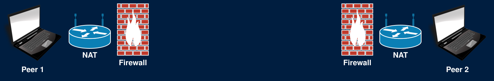{fig-alt="Each peer is behind a NAT and a firewall. There is no connection between them."}

## WebRTC - TURN Server

- In cases where peer-to-peer is blocked:
  - Use a TURN (Traversals Using Relays around NAT) Server
  - After the connection is established using a signaling server, each peer routes their streaming data through a TURN server

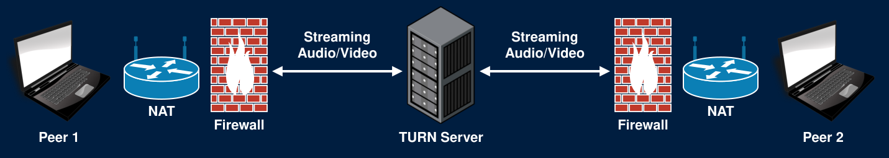{fig-alt="Each peer is behind a NAT and a firewall. Both peers stream audio and video to a TURN server, which relays it to the other peer."}

## WebRTC - TURN Server

- If you ask me... using a TURN server defeats the purpose of using a peer-to-peer technology
- ... Unless you run your own TURN server!

{fig-alt="Each peer is behind a NAT and a firewall. Both peers stream audio and video to a TURN server, which relays it to the other peer."}

# STUN in Detail

## Why Not Use the WebSocket's Address?

- Your signaling server already sees each peer's public IP: the source of their WebSocket connection
- But a NAT maps each socket separately
  - The TCP socket for the WebSocket gets one public port
  - The UDP socket for the video gets a different one
- Only a packet sent from the video's own UDP socket reveals its public IP and port
  - That's what a STUN request is

## STUN Messages

- RFC 8489. Runs over UDP, usually on port 3478 (Google's runs on 19302)
- Every message starts with a 20-byte header:

| Bytes | Field |
|---|---|
| 2 | Message type: `0x0001` Binding Request, `0x0101` Binding Success Response |
| 2 | Message length: the number of bytes after the 20-byte header |
| 4 | Magic cookie: always `0x2112A442` |
| 12 | Transaction ID: random, chosen by the client, copied into the response |

- The first 2 bits of every STUN message are 0, and the magic cookie marks it as STUN
  - WebRTC sends STUN, its encryption handshake, and the video itself on the same port

## Attributes

- After the header comes a list of attributes
  - Type (2 bytes), Length (2 bytes), Value (padded to a multiple of 4 bytes)
- A Binding Success Response needs one attribute: **XOR-MAPPED-ADDRESS** (type `0x0020`)

| Bytes | Field |
|---|---|
| 1 | `0x00` |
| 1 | Family: `0x01` for IPv4, `0x02` for IPv6 |
| 2 | X-Port: the port XOR `0x2112` (the first 2 bytes of the magic cookie) |
| 4 | X-Address: the IPv4 address XOR `0x2112A442` |

## Why XOR?

- The original STUN sent the address as-is (MAPPED-ADDRESS)
- Some NATs rewrite any 4 bytes in a packet that match their public IP
  - Meant to help older protocols that put addresses in their payloads
  - They corrupted STUN responses instead
- XOR with a known constant hides the address from those NATs
  - Trivial for the client to undo
- The same trick as WebSocket masking: change the bytes on the wire so nothing in between misreads them

## Example

- A Binding Request arrives from `23.34.59.30`, port `5670`
- X-Port: `5670 XOR 0x2112` = `0x1626 XOR 0x2112` = `0x3734`
- X-Address: `0x17223B1E XOR 0x2112A442` = `0x36309F5C`

```text
01 01  00 0C  21 12 A4 42  <the request's 12-byte transaction ID>    Header
00 20  00 08  00 01  37 34  36 30 9F 5C                              XOR-MAPPED-ADDRESS
```

- Message length `0x000C` = 12: the attribute's 4-byte type and length, plus its 8-byte value

## A STUN Server in Go

```go
conn, err := net.ListenPacket("udp", ":3478")
// handle err
buffer := make([]byte, 1500)
for {
    n, addr, err := conn.ReadFrom(buffer)
    // addr is the IP and port this packet came from: the answer to "What's my IP?"
    // Verify buffer[:n] is a Binding Request, then build the response
    conn.WriteTo(response, addr)
}
```

- No connection and no handshake: one packet in, one packet out
- Each packet is one complete message. No buffering!
- Validate everything. Anyone can send you a UDP packet
  - The type is `0x0001`, the cookie is `0x2112A442`, and the length matches the bytes you read

## Using Your STUN Server

```javascript
const peerConnection = new RTCPeerConnection({
    iceServers: [{urls: "stun:localhost:3478"}]
});
```

- Publish the port for UDP in your compose.yml: `"3478:3478/udp"`
  - Docker publishes TCP unless you say otherwise
- To verify it works:
  - Log every Binding Request your server receives
  - Look for `typ srflx` candidates in the `ice_candidate` messages passing through your signaling server
  - `chrome://webrtc-internals` shows every candidate the browser gathered
- On localhost, the address your server reports will be a Docker network address, not your public IP. That's expected

## ICE Candidate Types

| Type | Address |
|---|---|
| `host` | The device's own address on its local network |
| `srflx` | Server reflexive: the public address a STUN server reported |
| `relay` | An address on a TURN server that relays the traffic |

- The browser gathers every candidate it can, and sends each one through the signaling server
- Both peers try pairs of candidates, and keep the best pair that works
  - Usually: host (same network), then srflx (through NATs), then relay (last resort)

## Hole Punching

- A NAT drops unexpected incoming packets
  - It only lets in replies to something that was sent from inside
- Both peers send packets directly to each other's candidates at the same time
  - Each NAT sees an outgoing packet first, so it lets the other peer's packets in
- These connectivity checks are STUN Binding Requests too
  - Sent peer-to-peer, and authenticated with the `ice-ufrag` and `ice-pwd` from the offer and answer
- STUN is used twice: once to learn your public address, then again to test every candidate pair

## When STUN Isn't Enough

- Hole punching works when the NAT uses the same public port for every destination
- A **symmetric** NAT picks a new public port for each destination
  - The port the STUN server saw is not the port the peer will see
  - The peer's packets go to the wrong port, and are dropped
- Common on corporate and mobile networks
- The fallback: a TURN server

## Hidden Local Addresses

- A `host` candidate contains your local IP address
  - Any site could collect it, even without a video call
- Unless the page has camera or microphone permission, Chrome replaces the address with a random name:

```text
candidate:2382557538 1 udp 2122260223 4b8d3c1e-7a51-4c2b-9f3e-2d6a8b0c1e57.local 54090 typ host
```

- Peers on the same network look the name up with mDNS. Everyone else learns nothing
- You may see either form in the messages passing through your signaling server
