# WebRTC


## WebRTC - Overview

- Web Real Time Communication
- Establishes a live streaming peer-to-peer connection
  - We'll stream video and audio to make a video chat app
- Stable release in 2018
- Widely adopted by major browsers
  - Most of the WebRTC logic/code is built into your browser

## WebRTC - Overview

- WebRTC establishes a live streaming peer-to-peer connection
- Peer-to-peer
  - Two clients will communicate without the use of a server
  - Your server will only help the clients establish the connection
  - The server does not handle the steaming data
- Live streaming
  - The protocol is meant for live (real-time) streaming
  - End-to-end delay is critical!
  - Even a small delay will result in clients talking over each other on a voice/video call

## WebRTC - Overview

- TCP can be slow!
  - Meant for reliability
  - If a packet is dropped, request a resend and wait
  - Only deliver bytes after all packets arrive and are reassembled
  - Not suitable for live [real-time] streaming*

Other protocols are used when delays are tolerable (ie. not real-time) like YouTube Live or Twitch

## WebRTC - Overview

- WebRTC uses UDP instead of TCP
- UDP (User Datagram Protocol)
  - Meant for speed
  - If a packet is dropped, it's lost forever. Move on with your life
  - Bytes are delivered as soon as they are received
  - Very close to using raw IP packets

## WebRTC - Overview

- Servers are still involved
  - We'll discuss 3 types of servers that assist in WebRTC connections
- Signalling Server
  - Passes messages between clients to help them establish a peer-to-peer connection
  - Once the connection is established, the server's job is done (Unless you want to pass a disconnect message)
- STUN (Session Traversal Utilities for NAT) Server
  - A server that tells clients their public IP/port
- TURN (Traversal Using Relays around NAT) Server
  - Optional for WebRTC connections [Most of the time]
  - All WebRTC packets for a connection are routed through the TURN server if one is used

## WebRTC

- Need to establish a real-time streaming peer-to-peer connection
- But how?
  - Need the IP address of your peer
  - Need to agree on the details of the connection

::: {.absolute bottom=0 left=0 width="100%"}
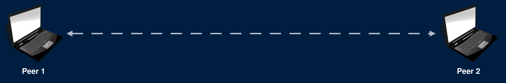{fig-alt="Two peers with a dashed two-way arrow between them: they want a direct peer-to-peer connection."}
:::

## WebRTC - Connecting

- One peer needs to get an offer to the other peer
- This is an offer to establish a connection that contains:
  - audio/visual codec, bitrate, etc details (How to interpret the bytes once the streaming starts)
  - A username fragment ("ice-ufrag") as a unique identifier

::: {.absolute bottom=0 left=0 width="100%"}
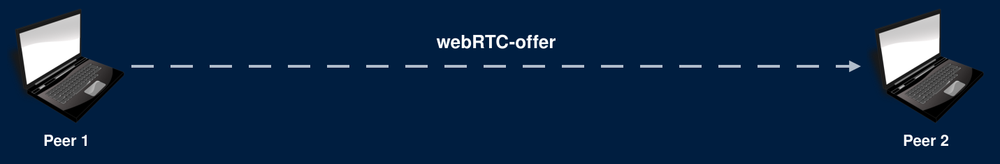{fig-alt="Peer 1 sends a webRTC-offer to peer 2."}
:::

## WebRTC - Connecting

- The peer responds with an answer
- The answer contains their audio/visual data
- Contains their own ufrag so the connection can be identified
- Once the answer is received, the peers agree to connect

::: {.absolute bottom=0 left=0 width="100%"}
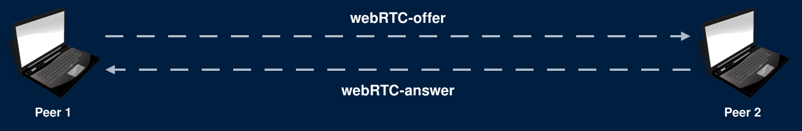{fig-alt="Peer 1 sends a webRTC-offer to peer 2, and peer 2 replies with a webRTC-answer."}
:::

## WebRTC - Connecting

- But there's a problem
- How do we send these messages between two peers?

::: {.absolute bottom=0 left=0 width="100%"}
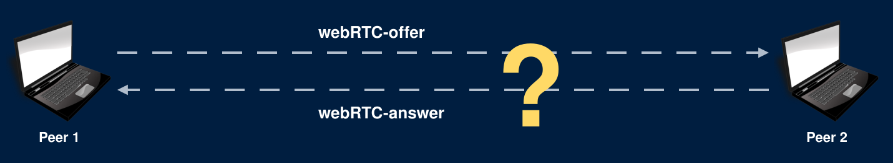{fig-alt="Peer 1 sends a webRTC-offer to peer 2, and peer 2 replies with a webRTC-answer. A large question mark sits between them: how do these messages reach the other peer?"}
:::

## WebRTC - Connecting

- For usual web traffic with a server:
  - Type in a domain name or click a link containing a domain name
  - Use DNS to lookup the [static] IP address of the server
  - Send a request to the IP address on port 80 or 443

::: {.absolute bottom=0 left=0 width="100%"}
{fig-alt="Peer 1 sends a webRTC-offer to peer 2, and peer 2 replies with a webRTC-answer. A large question mark sits between them: how do these messages reach the other peer?"}
:::

## WebRTC - Connecting

- For peer-to-peer traffic:
  - We need to discover the IP and port of the peer without DNS
  - Peer IP/port can change (dynamic IP)

::: {.absolute bottom=0 left=0 width="100%"}
{fig-alt="Peer 1 sends a webRTC-offer to peer 2, and peer 2 replies with a webRTC-answer. A large question mark sits between them: how do these messages reach the other peer?"}
:::

## WebRTC - Signalling Server

- Offer and answer are sent through a signaling server
  - On the HW - You are the signaling server!!
- Both peers connect to your server
- Send offer/answer to the server and the server forwards the messages to the other peer

::: {.absolute bottom=0 left=0 width="100%"}
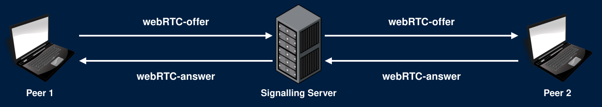{fig-alt="Peer 1 sends a webRTC-offer to the signalling server, which forwards it to peer 2. Peer 2 sends a webRTC-answer to the signalling server, which forwards it to peer 1."}
:::

## WebRTC - Signalling Server

- We need a method to send these messages
- We'll need a way for the server to be able to send messages to each client in real-time

::: {.absolute bottom=0 left=0 width="100%"}
{fig-alt="Peer 1 sends a webRTC-offer to the signalling server, which forwards it to peer 2. Peer 2 sends a webRTC-answer to the signalling server, which forwards it to peer 1."}
:::

## WebRTC - Signalling Server

- We need a method to send these messages
- We'll need a way for the server to be able to send messages to each client in real-time
- Wow! It's really convenient that we have WebSockets!

::: {.absolute bottom=0 left=0 width="100%"}
{fig-alt="Peer 1 sends a webRTC-offer to the signalling server, which forwards it to peer 2. Peer 2 sends a webRTC-answer to the signalling server, which forwards it to peer 1."}
:::

## WebRTC - Signalling Server

- When your server receives a WebSocket frame containing an offer or answer
  - Send the payload to the other peer over their WebSocket

::: {.absolute bottom=0 left=0 width="100%"}
{fig-alt="Peer 1 sends a webRTC-offer to the signalling server, which forwards it to peer 2. Peer 2 sends a webRTC-answer to the signalling server, which forwards it to peer 1."}
:::

## WebRTC - NATs

- We have another issue..
- How do we know the IP address and port for each peer?

::: {.absolute bottom=0 left=0 width="100%"}
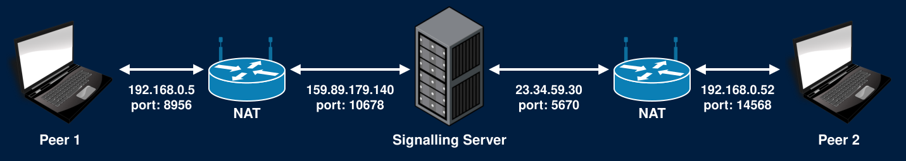{fig-alt="Peer 1 has local address 192.168.0.5 port 8956 behind a NAT, which talks to the signalling server from public address 159.89.179.140 port 10678. Peer 2 has local address 192.168.0.52 port 14568 behind a NAT, which talks to the signalling server from public address 23.34.59.30 port 5670."}
:::

## WebRTC - NATs

- Devices are commonly "hidden" behind NAT routers
  - Network Address Translation
- With a NAT:
  - You have a local IP address for communication on your local network
  - When communicating outside your network, the NAT router sends your message using a public IP address and port number

::: {.absolute bottom=0 left=0 width="100%"}
{fig-alt="Peer 1 has local address 192.168.0.5 port 8956 behind a NAT, which talks to the signalling server from public address 159.89.179.140 port 10678. Peer 2 has local address 192.168.0.52 port 14568 behind a NAT, which talks to the signalling server from public address 23.34.59.30 port 5670."}
:::

## WebRTC - NATs

- With a NAT:
  - Many devices on a local network can share a single public IP address
  - Each device does not know it's public IP/port used when it communicates to the outside world
  - [Also the problem that port-forwarding solves]

::: {.absolute bottom=0 left=0 width="100%"}
{fig-alt="Peer 1 has local address 192.168.0.5 port 8956 behind a NAT, which talks to the signalling server from public address 159.89.179.140 port 10678. Peer 2 has local address 192.168.0.52 port 14568 behind a NAT, which talks to the signalling server from public address 23.34.59.30 port 5670."}
:::

## WebRTC - STUN Server

- Solution: Use a STUN (Session Traversal Utilities for NAT) Server
- Each peer connects to a STUN server and asks for their public IP/port
- STUN server checks the origin IP/port and informs the client
- We'll use Google's free STUN server (stun.l.google.com:19302)

::: {.absolute bottom=0 left=0 width="100%"}
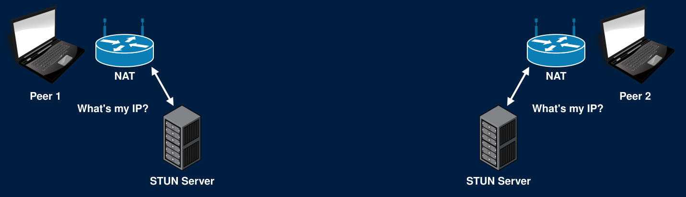{fig-alt="Each peer, behind its NAT, asks a STUN server: What's my IP?"}
:::

## WebRTC - ICE Candidate

- Each peer sends their public IP/port, and connection information, in an ICE (Interactive Connectivity Establishment) candidate message
- Whenever your signaling server receives an ICE candidate, forward it to the other peer

::: {.absolute bottom=0 left=0 width="100%"}
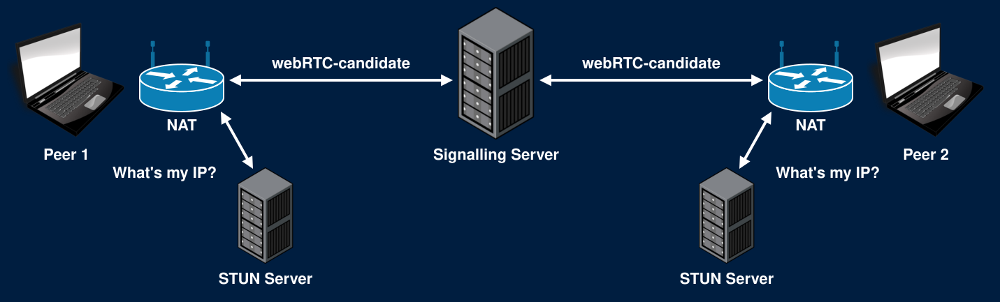{fig-alt="Each peer asks its STUN server: What's my IP? Then each peer sends a webRTC-candidate through the signalling server to the other peer."}
:::

## WebRTC - ICE Candidate

- Candidate contains:
  - Connection type - UDP, not TCP
  - IP/port - Local in this example
  - Username fragment - Uniquely identifies the connection

::: {.absolute bottom=0 left=0 width="100%"}
{fig-alt="Each peer asks its STUN server: What's my IP? Then each peer sends a webRTC-candidate through the signalling server to the other peer."}
:::

## WebRTC - ICE Candidate

```{.json .code-overflow-wrap}
{"candidate":"candidate:2382557538 1 udp 2122260223 192.168.1.19 54090 typ host generation 0 ufrag FGP/
 network-id 1 network-cost 10","sdpMid":"0","sdpMLineIndex":0}
```

::: {.absolute bottom=0 left=0 width="100%"}
{fig-alt="Each peer asks its STUN server: What's my IP? Then each peer sends a webRTC-candidate through the signalling server to the other peer."}
:::

## WebRTC - Connection

- And now we can establish a peer-to-peer connection!

::: {.absolute bottom=0 left=0 width="100%"}
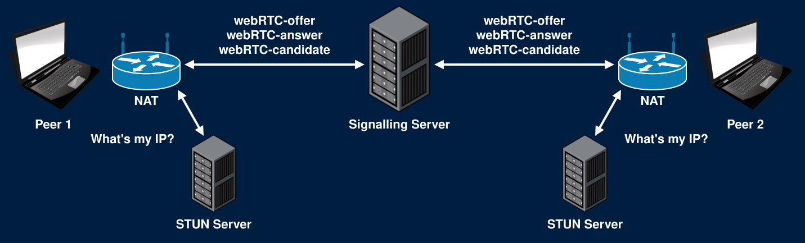{fig-alt="Each peer asks its STUN server: What's my IP? The webRTC-offer, webRTC-answer, and webRTC-candidate messages travel between the peers through the signalling server."}
:::

## WebRTC - Summary

- One peer sends an offer to the other
- Other peer responds with an answer
- Both peers get their public IP/port from their STUN Servers
- Both peers send their ICE candidates to the other

::: {.absolute bottom=0 left=0 width="100%"}
{fig-alt="Each peer asks its STUN server: What's my IP? The webRTC-offer, webRTC-answer, and webRTC-candidate messages travel between the peers through the signalling server."}
:::

## WebRTC - Summary

- Once the connection is established
- The servers step aside and the clients stream directly to each other
  - True peer-to-peer!

::: {.absolute bottom=0 left=0 width="100%"}
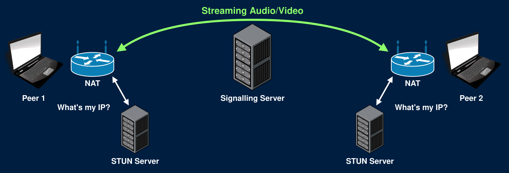{fig-alt="The peers stream audio and video directly to each other. The signalling server and STUN servers are no longer involved."}
:::

## WebRTC - Summary

- Your role in all of this?
  - Route the offer/answer/candidate messages between peers
- No need to read/parse/interpret the RTC portion of these messages
  - Extract the payload from the WS frame, send it to the appropriate peer as a new WS frame

::: {.absolute bottom=0 left=0 width="100%"}
{fig-alt="Each peer asks its STUN server: What's my IP? The webRTC-offer, webRTC-answer, and webRTC-candidate messages travel between the peers through the signalling server."}
:::

## WebRTC - Restrictions

- The browser will not allow WebRTC connections when connected to a site using HTTP (as opposed to HTTPS)
- Must have an encrypted connection to use WebRTC
  - *Unless connecting over localhost (Let's us test locally)

::: {.absolute bottom=0 left=0 width="100%"}
{fig-alt="Each peer asks its STUN server: What's my IP? The webRTC-offer, webRTC-answer, and webRTC-candidate messages travel between the peers through the signalling server."}
:::

## WebRTC - Restrictions

- Sometimes a peer-to-peer connection cannot even be established
  - Can have restrictive firewalls
  - Dynamic NATs might change your port unexpectedly
  - Organizations might block certain traffic on their network

::: {.absolute bottom=0 left=0 width="100%"}
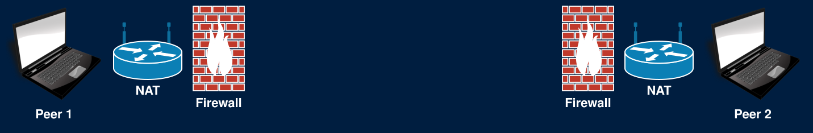{fig-alt="Each peer is behind a NAT and a firewall. There is no connection between them."}
:::

## WebRTC - TURN Server

- In cases where peer-to-peer is blocked:
  - Use a TURN (Traversals Using Relays around NAT) Server
  - After the connection is established using a signaling server, each peer routes their streaming data through a TURN server

::: {.absolute bottom=0 left=0 width="100%"}
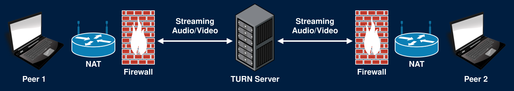{fig-alt="Each peer is behind a NAT and a firewall. Both peers stream audio and video to a TURN server, which relays it to the other peer."}
:::

## WebRTC - TURN Server

- If you ask me... using a TURN server defeats the purpose of using a peer-to-peer technology
- ... Unless you run your own TURN server!

::: {.absolute bottom=0 left=0 width="100%"}
{fig-alt="Each peer is behind a NAT and a firewall. Both peers stream audio and video to a TURN server, which relays it to the other peer."}
:::
