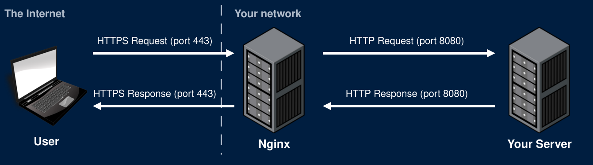

# HTTPS with Nginx

## The Problem

- We want to use HTTPS
  - Encrypts all web traffic
- Prefer not to modify your app code
  - Makes our code more modular and portable
  - Your HTTPS setup can change without changing your app
- Solution: Use a reverse proxy

## Nginx

- Nginx has many uses and is very powerful software
  - Recall that it was used for our RTMP ingest server
- For now, we'll use it here as a reverse proxy to enable HTTPS
  - We'll setup HTTPS now. Later lectures will explain what HTTPS is and how it works
- One nginx can route requests
  - On the project: route /register, /login, and /logout to your auth service, and everything else to your app
  - Nginx could serve your static files
  - Can route by domain name to host many apps on the same server

## Nginx Strategy

- Use Nginx to listen for HTTPS requests
  - Nginx needs a cert and private key
- Nginx will decrypt requests and forward them to your server as HTTP requests
  - These unencrypted requests are sent over a local network and never touch the Internet
  - They do not need to be encrypted
- Your server sends HTTP responses to Nginx
  - Nginx encrypts and sends the HTTPS response over the Internet
- If Nginx gets an HTTP request (port 80) redirect the user to HTTPS (port 443)

## Nginx Strategy {.unnumbered .unlisted}

{fig-alt="On the Internet, the user sends an HTTPS request on port 443 to Nginx. Inside your network, Nginx forwards it as an HTTP request on port 8080 to your server. Your server sends an HTTP response on port 8080 back to Nginx, and Nginx sends an HTTPS response on port 443 back to the user."}

# Certificates

## OpenSSL

- OpenSSL is a very common SSL/TLS library
  - Written in C
  - Wrappers exist for many languages
- Can be used for many encryption needs
  - Generating keys
  - Signing certs
  - Validating certs
- Can use OpenSSL in the command line to generate self-signed certificates

## Self-Signed Certificate

```bash
openssl req -x509 -newkey rsa:4096 -keyout private.key -out cert.pem -days 365 -sha256 -nodes -subj "/C=US"
```

- This command will generate a self-signed certificate and a private key
  - Private key saved as private.key
  - Certificate saved as cert.pem
- The browser warns every user: no certificate authority vouched for it
  - Fine for testing. Not for a deployed app

## Let's Encrypt

- A certificate authority that issues free certificates
  - Trusted by every major browser
- Before issuing a certificate, it checks that you control the domain
  - The script generates a random file and edits your nginx config to host the file
  - It then asks for the file at your domain name
  - Only the server your domain points to can serve that file
  - If it gets the file, you must control that domain name
- Certbot automates all of this

## Certbot

- Saves your certificate and private key:
  - `/etc/letsencrypt/live/example.com/fullchain.pem`
  - `/etc/letsencrypt/live/example.com/privkey.pem`
- Edits your nginx config to use these files

## Domain Names

- Register a domain name
  - The GitHub Student Developer Pack includes a free domain for 1 year
- Add an A record that maps your domain to your server's public IP
  - `example.com` → `159.89.179.140`
- DNS changes can take minutes to hours to reach everyone
  - It's often seconds, but be prepared in case it takes hours
- Get your DNS working before running Certbot
  - Certbot cannot verify your domain name if you don't have one setup

# Nginx Configuration

## Redirect HTTP to HTTPS

```nginx
server {
    listen 80;
    server_name yourgame.me;
    return 301 https://$host$request_uri;
}
```

- Any request on port 80 gets a 301 to the same path over HTTPS
- `$host` and `$request_uri` are filled in by nginx for each request
- Certbot can set this up for you

## Terminate TLS and Proxy

```nginx
server {
    listen 443 ssl;
    server_name example.com;
    ssl_certificate     /etc/letsencrypt/live/yourgame.me/fullchain.pem;
    ssl_certificate_key /etc/letsencrypt/live/yourgame.me/privkey.pem;

    location / {
        proxy_pass http://127.0.0.1:8080;
        proxy_http_version 1.1;
    }
}
```

- localhost is an alias for 127.0.0.1
  - Using 127.0.0.1 does not require resolution
  - They can mostly be used interchangeably

## WebSockets Through Nginx

```nginx
location /websocket {
    proxy_pass http://127.0.0.1:8080;
    proxy_http_version 1.1;
    proxy_set_header Upgrade $http_upgrade;
    proxy_set_header Connection "upgrade";
}
```

- location uses prefix routing by default
  - Any path starting with /websocket gets routed with this config
- Upgrade and Connection apply to one hop only. Nginx drops them unless you set them again

## WSS in the Front End

- A page loaded over HTTPS can't open a `ws://` connection
  - The browser blocks it as mixed content
- Pick the protocol from the page's own protocol:

```javascript
const protocol = location.protocol === "https:" ? "wss://" : "ws://";
const socket = new WebSocket(protocol + location.host + "/websocket");
```

- The same code works at `http://localhost:8080` and on your deployed domain


# Deploying

## Nginx with Docker Compose

```yaml
services:
  nginx:
    image: nginx
    ports:
      - "80:80"
      - "443:443"
    volumes:
      - ./nginx.conf:/etc/nginx/conf.d/default.conf
```

- Only nginx publishes ports. Your app and database are reachable by name inside the compose network
- [Never publish your database's port on a public server]{.yellow}
- Useful for routing between auth server and app, or hosting static files through nginx

## Local and Deployed

- Locally there's no domain and no certificate
  - Nginx listens on port 8080 with plain HTTP
- On the server, nginx listens on 80 and 443 with your certificate
- Two options:
  - Use a separate nginx config for each, or a separate compose.yml
  - Run nginx though docker compose only for routing. Run a second nginx on your server for HTTPS

## Secure Cookies

- Once you have HTTPS
- Add the `Secure` directive to your auth cookies
  - The browser only sends them over HTTPS

